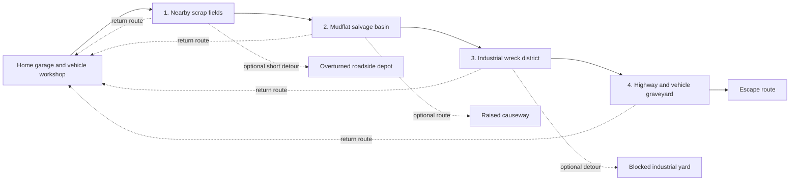

# Junkyard Run — World and Level Plan

**Status:** Broad structure approved for the next planning step. The four region archetypes are distinct enough to carry into a simple route sketch; names, geography, routes, landmarks, final zone count, and progression details remain provisional.

This plan captures the current direction for the game world before map blockout or background/art work. It is not a detailed level design and does not change the Unity test scene. See [PROJECT_CONTEXT.md](PROJECT_CONTEXT.md) for the core game direction and [PROTOTYPE_PROGRESS.md](PROTOTYPE_PROGRESS.md) for mechanics currently implemented in NetRange.

## Goals and guardrails

- Build one continuous, driveable world around a permanent home garage/base.
- Use a mostly linear outward route with a few optional detours and return shortcuts. All major regions are reachable by driving from the beginning; progression is not enforced with vehicle-upgrade locks.
- Target **3–4 major regions**. Use four as a planning placeholder, not a final content commitment.
- Let each region contain several connected areas, rather than treating every landmark as a separate level.
- Let players leave the vehicle to scout or collect scrap on foot. Keep it within sight in open regions; allow short out-of-sight detours in denser areas, but avoid long detached excursions.
- Make each region change how the group catches, carries, protects, and hauls scrap. Keep slapstick co-op physics as the common identity.
- Keep the opening playable slice small: one nearby region supports catching scrap, a thief, cart hauling, banking, and crafting one vehicle part. It needs no boss.
- Do not turn the NetRange mechanics scene, its 40-by-40 test ground, or its coordinates into canonical world scale.

## Macro route — first draft

The diagram describes a **single continuous landscape**, not map-select missions or hard level-load gates. The numbered chain is a geographic/story route, not a lock sequence: every region is driveable from the start. Lines are broad drivable corridors; the optional links are candidate branches, not committed routes. Each major region can be authored or streamed as a separate technical chunk later as long as travel feels continuous.

## Provisional region archetypes

| Order | Region concept | Place identity | Main traversal / cart problem | Threat role | Broad payoff |
|---|---|---|---|---|---|
| 1 | Nearby scrap fields | A roadside dump and its surrounding junk heaps, close enough to see home | Open, readable routes; teach pushing and delivery with a manageable haul | First thief encounters; no boss required | Basic salvage to learn banking and craft the first useful vehicle part |
| 2 | Mudflat salvage basin | A flooded lowland of stranded machinery and scrap islands | Mud slows the cart; some loads may need a team lift-and-push or a longer dry route | Threats pressure the group while players coordinate around a slow cart | Salvage that broadly improves hauling or access through soft ground |
| 3 | Industrial wreck district | A dense scrapyard/industrial edge with blocked service roads | Tight turns, uneven clutter, and barricades reward route choice and capable vehicle handling | Candidate home for the ram, barricade, and giant-raccoon sequence; this is a later progression beat, not the opening slice | Vehicle-building salvage and optional shortcuts through the district |
| 4 | Highway and vehicle graveyard | A remote interchange and field of abandoned vehicles toward the escape route | Longer exposed haul; damaged roads and optional shortcuts reward careful driving and vehicle improvements | Late-run pressure and a possible major threat remain open | High-value vehicle salvage and access to the final escape-route stretch |

These entries describe **gameplay identity**, not exact art direction, recipes, geometry, encounter counts, or boss requirements. The final number and order of regions may change after checking scope and progression. No region is intended to require a specific vehicle upgrade to enter.

## How a region can be composed

Use these as broad planning ingredients, not a mandatory repeated formula or detailed layout:

1. **Approach:** A visible landmark and an initial route decision, with enough room to understand where the cart can travel.
2. **Main salvage area:** The region's central scavenging opportunity and clearest expression of its traversal challenge.
3. **Optional detour:** A smaller salvage risk/reward or a useful shortcut that the group can choose to attempt.
4. **Return connection:** A driveable route back toward the permanent base; alternate roads can offer different lengths or hazards.

The opening region should stay compact and teach the basic loop before adding harder traversal or boss encounters. Later connected areas can extend the expedition and expose the group to more risk, while the base remains the place where unbanked salvage becomes secure and vehicle progress is made. In open areas, keep the vehicle visible during foot exploration; in dense areas, allow short detours out of sight, but do not depend on long on-foot treks detached from the cart.

## Progression principles

- Progress mostly forward along a readable main route, with optional branches for extra salvage or shortcuts.
- All regions are reachable from the start; vehicle improvements make routes easier, safer, or faster and may open optional shortcuts, but do not gate access to a whole region.
- Keep the starting/early expedition near home so players learn the core loop and can bank often.
- Let later expeditions feel longer through distance, route hazards, and more salvage choices; do not move or replace the home base.
- Vary foot-exploration distance by region: vehicle in sight in open terrain, short out-of-sight detours only where denser layouts justify them.
- Place the ram/barricade/raccoon concept later than the opening zone. Treat its precise region and unlock sequence as provisional.
- Treat deep mud as a candidate region-defining challenge; its exact order and cooperative rules still need testing.

## Scope and current next step

Do not build detailed backgrounds, scenery, or final art yet. First review the region order and broad map logic. Then make a simple top-down route sketch with only the home, main road, region boundaries/landmarks, a few branches, and broad return paths. Use that sketch to check driveability, travel length, and whether every region supports the core scavenging/cart loop. The first Unity blockout should begin only after the route and first-region scope are agreed.

The current NetRange scene is a standalone mechanics test, not the first region blockout. Reuse its net, bag, thief, cart, banking, and refill tests later as mechanics references; do not copy its dimensions or coordinates onto the world map.

## Open questions for the next review

1. What should the continuous world's rough travel scale and return-trip length feel like? Decide this while sketching the route, before any detailed blockout.
